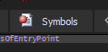
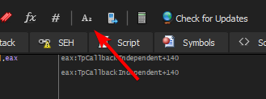
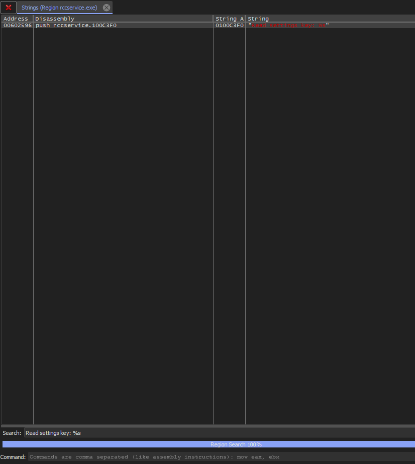
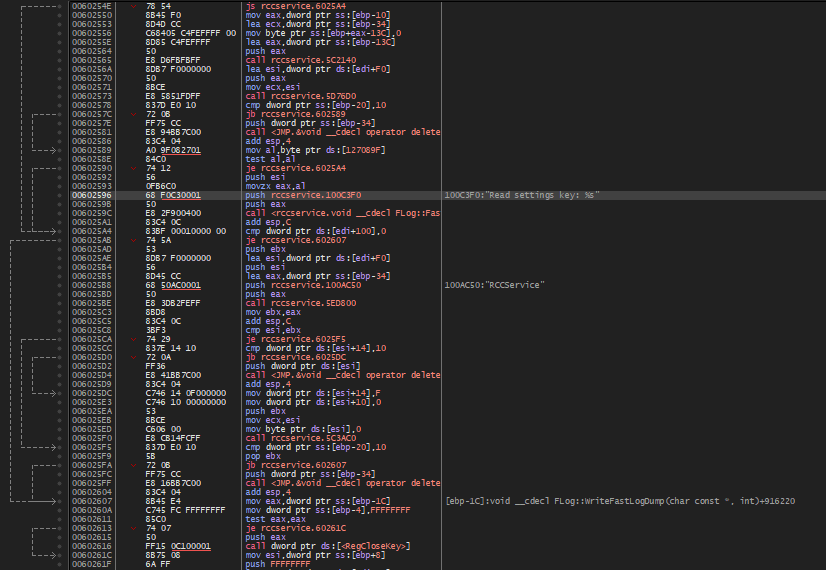
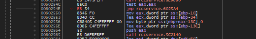
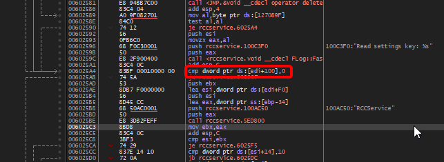
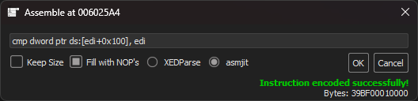
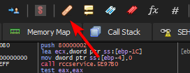
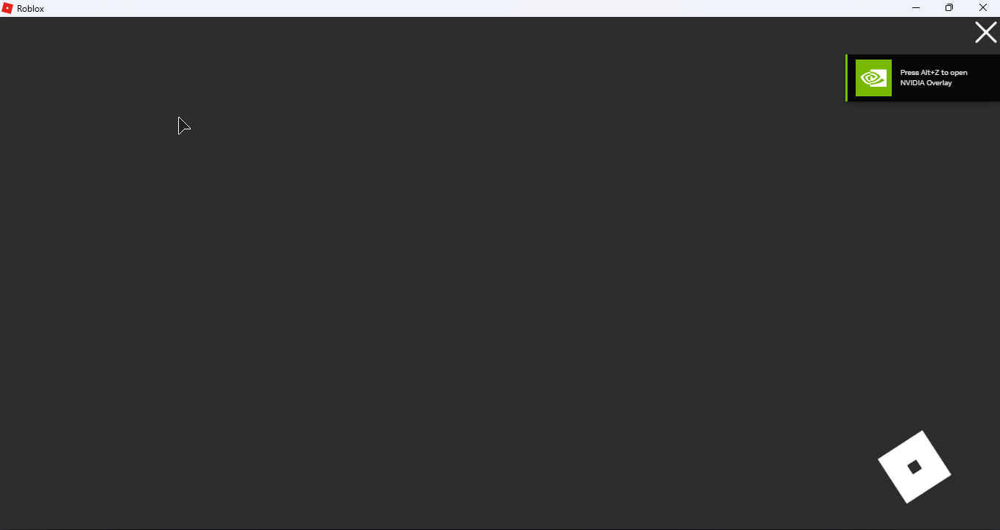

Credit to _SomeoneInTheWorld_ for being the original author (@yakovexplorer on GitHub).

# Force ~2018 RCCService to Fetch FFlags the Right Way

For some reason, Rōblox decided that the "RCCService" FFlags should be only fetched when a particular key is present in the registry. We should make it fetch FFlags no matter what.

## Quick Guide

This guide is useful for old-Rōblox launchers and revivals.

Yakov's [original patch](./v227-server.1337) was not intended for Rōblox Freedom Distribution, as it targeted versions **significantly** older than 0.347 (released in July 2018).

VisualPlugin independently arrived at the same patch procedure and produced signatures for [v347](./v347-server.1337) and [v463](./v463-server.1337).

### (1) Searching

Search for `"Read settings key: %s"` in user-module string references

Open x32dbg with your RCCService executable. Then click on "Symbols".



Find your executable name and double-click on it. You must have been dropped back to the CPU tab. If not, then manually go to the CPU tab.<br>
Then click the little "Az" icon in the top bar.



Then you will be in the "References" tab. Wait until the progress bar at the bottom finishes, and type in the "Search:" field the phrase "Read settings key: %s", like this:



Double click on the reference found.

### (2) Assembly

The hardest part. You might see a lot of instructions like these now:



First things first, find a `js` instruction above these 6:

```
00602550 | 8B45 F0                  | mov eax,dword ptr ss:[ebp-10]           |
00602553 | 8D4D CC                  | lea ecx,dword ptr ss:[ebp-34]           |
00602556 | C68405 C4FEFFFF 00       | mov byte ptr ss:[ebp+eax-13C],0         |
0060255E | 8D85 C4FEFFFF            | lea eax,dword ptr ss:[ebp-13C]          |
00602564 | 50                       | push eax                                |
00602565 | E8 D6FBFBFF              | call rccservice.5C2140                  |
```

Select it, press space, change `js` to `jmp` and press OK. We have patched the settings key fetch code. It must look like this now:



After you have done that, find this instruction:



Select it, press space, change `0x00` to `edi` like the image below and press OK.

**WARNING: Make sure you have "Fill with NOP's" enabled, otherwise it will eat the "je" instruction!**



This patch makes the `cmp` instruction always true, so it continues to construct the "RCCService" string for it to be passed to the FFlag loader.

You are done now. Press the band-aid icon in the topbar:



Click "Patch", and save the executable.

## Triage

Reddit user \@Stunning_Art_2345 reported a problem which I could not easily reproduce. I reframed his messages into an [Issue](https://github.com/Windows81/Roblox-Freedom-Distribution/issues/201) on GitHub:

> I followed what you did in the video but the client just got stuck on the loading screen

> it pops up as normal but just doesnt load up the actual game:



Analysing his logs, I discovered the culprit to be probably quite interesting. His v347 RCCService is attempting to load FFlags, et c. from the _wrong_ URL. Instead of `/Setting/QuietGet/RCCService/`, he loads from `/Setting/QuietGet/RCCServicesCUEjOvfAStkcwZ7wCbt0D9c3OLxuRgzDBew9jr5Hf4qloF9/`. Weird.

Fortunately for us, v347 was only compiled only two years _after_ [what we have in the Rōblox 2016 source code](https://github.com/Artifaqt/ROBLOX2016/blob/main/RCCService/RCCServiceSoapServiceImpl.cpp#L1381), which tells us that:

```cpp
std::string CWebService::GetSettingsKey()
{
#ifdef RBX_TEST_BUILD
	if (RCCServiceSettingsKeyOverwrite.length() > 0)
		return RCCServiceSettingsKeyOverwrite;
#endif

	if (settingsKey.length() == 0)
	{
		CRegKey key;
		if (SUCCEEDED(key.Open(HKEY_LOCAL_MACHINE, "Software\\ROBLOX Corporation\\Roblox\\", KEY_READ)))
		{
			CHAR keyData[MAX_PATH];
			ULONG bufLen = MAX_PATH-1;
			if (SUCCEEDED(key.QueryStringValue("SettingsKey", keyData, &bufLen)))
			{
				keyData[bufLen] = 0;
				settingsKey = std::string(keyData);
				FASTLOGS(FLog::RCCServiceInit, "Read settings key: %s", settingsKey);
			}
		}

		if (settingsKey.length() != 0)
			settingsKey = "RCCService" + settingsKey;
	}

	return settingsKey;
}
```

From the code snippet, I assume that the user had a registry value stored at `Software\ROBLOX Corporation\Roblox\SettingsKey`. This was probably from another revival program they installed.

## Tracing Through

A fix should be easy. Our goal is to make sure the if-condition at `SUCCEEDED(key.Open(HKEY_LOCAL_MACHINE, "Software\\ROBLOX Corporation\\Roblox\\", KEY_READ))` is _always_ false.

### Step 1: Find String References

Find references to `"SettingsKey"`.

- In `RCCService.exe` v463, I found _one_ result appears.
- In `RCCService.exe` v347, _two_ results appear; follow the rest of the steps for both.

| Address    | Disassembly               | String Address | String          |
| ---------- | ------------------------- | -------------- | --------------- |
| `004A59EE` | `push rccservice.10BFC38` | `010BFC38`     | `"SettingsKey"` |
| `004A5A8A` | `push rccservice.10BFC38` | `010BFC38`     | `"SettingsKey"` |

### Step 2: Overwrite Assembly Bytes

Shortly after each reference to `"SettingsKey"`, you'll find a `call` statement. This likely jumps to `CRegKey::QueryStringValue`. Again: our goal is to make sure the corresponding if-condition is _always_ false.

This can be done by:

1. outright bypassing the `call` and its preceding `push` instructions, and
2. making the following `jl` into an unconditional `jmp`.

For example:

```patch
 004A5A76 | 7C 7C                    | jl rccservice.4A5AF4                 |
-004A5A78 | C745 EC 03010000         | mov dword ptr ss:[ebp-14],103        |
-004A5A7F | 8D4D EC                  | lea ecx,dword ptr ss:[ebp-14]        |
-004A5A82 | 51                       | push ecx                             |
-004A5A83 | 8D95 84FDFFFF            | lea edx,dword ptr ss:[ebp-27C]       |
-004A5A89 | 52                       | push edx                             |
-004A5A8A | 68 38FC0B01              | push rccservice.10BFC38              | 10BFC38:"SettingsKey"
-004A5A8F | 8D4D D4                  | lea ecx,dword ptr ss:[ebp-2C]        |
-004A5A92 | E8 79ECFFFF              | call rccservice.4A4710               |
-004A5A97 | 85C0                     | test eax,eax                         |
-004A5A99 | 7C 59                    | jl rccservice.4A5AF4                 |
+004A5A78 | 90                       | nop                                  |
+004A5A79 | 90                       | nop                                  |
+004A5A7A | 90                       | nop                                  |
+ ...
+004A5A97 | 90                       | nop                                  |
+004A5A98 | 90                       | nop                                  |
+004A5A99 | EB 59                    | jmp rccservice.4A5AF4                |
 004A5A9B | 8B45 EC                  | mov eax,dword ptr ss:[ebp-14]        |
 004A5A9E | C68405 84FDFFFF 00       | mov byte ptr ss:[ebp+eax-27C],0      |
```
